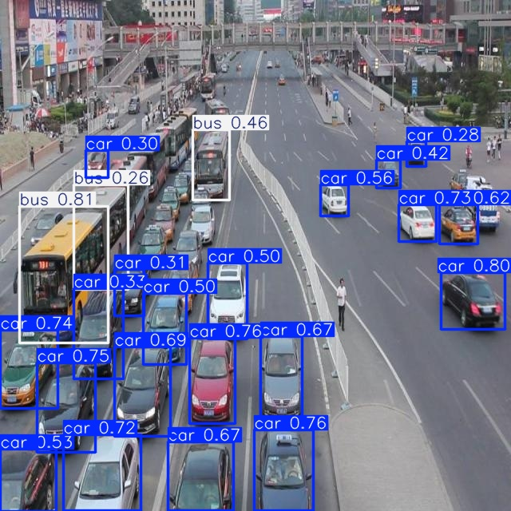
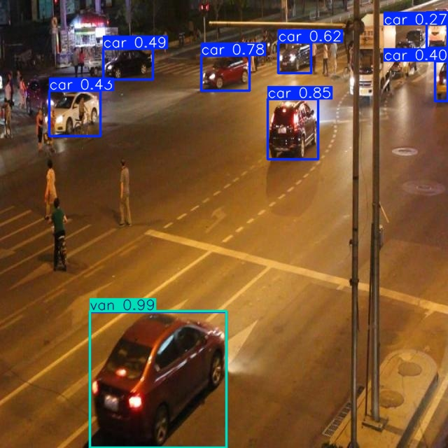

# Báo cáo cá nhân — Ngày 2 Object Detection

## 1. Thông tin học viên

- Họ tên: Bùi Thanh Tân
- MSSV: 2A202603304
- Email: tanbtt29042004@gmail.com
- Lớp: K5 – L2B
- Link repo bài làm: https://github.com/tantan294/K5-L2B-DAY02-BuiThanhTan-2A202603304-ObjectDetection
- Link Colab đã chạy: https://colab.research.google.com/drive/1BWsWl13mKr3_wm_rRNf2NH1JtkEmGQLp?usp=sharing

## 2. Schema và mini guideline

Em ghi chi tiết trong [GUIDELINE_MINI.md](../../GUIDELINE_MINI.md). Em giữ nguyên schema của bài: `0 car, 1 truck, 2 bus, 3 van` (khớp `data.yaml`).

Các ca mơ hồ em đã quyết định:

| Ảnh | Ca mơ hồ | Quyết định của em |
|---|---|---|
| `drive_023` | Xe buýt 2 tầng bị rìa phải và rìa trên cắt, chỉ thấy hông xe | `bus`, box kéo chạm rìa ảnh |
| `drive_039` | Xe ben chở đất che một phần xe buýt nối toa; một xe buýt khác bị rìa trái cắt | Xe ben là `truck`; mỗi xe buýt nối toa là một box `bus` trên phần nhìn thấy |
| `drive_026` | SUV trắng thân cao, có giá nóc, dễ nhầm với `van` | `car`, vì phóng to thấy capô dài, đuôi ngắn |
| `drive_026` | Xe cứu hộ trắng–xanh có cần kéo, dễ nhầm với van chuyên dụng | `truck`, vì cabin tách với sàn kéo và xe không chở khách |

Em gán lớp theo **loại xe**, không theo trạng thái (đỗ hay chạy). Box chỉ bao phần nhìn thấy và chạm rìa khi xe bị cắt khung. Em không gán xe máy, xe đạp, người hay xe trong ảnh quảng cáo.

Phần em muốn thầy/cô làm rõ:
- Mã lớp trong gold có khớp `data.yaml` không. Em thấy xe buýt trong gold được ghi ID 3 (chi tiết ở mục 4).
- Ranh giới giữa `van` và `bus`, và kích thước tối thiểu để gán xe ở rất xa.

## 3. Annotation và self-QC

- Số file nhãn train: **50/50** file. Bản khóa ban đầu có 460 box; bản sau sửa có **490 box** (460 `car`, 7 `truck`, 17 `bus`, 6 `van`).
- Checker: `python tools/check_yolo_labels.py` báo `ĐẠT cấu trúc: 50/50 file nhãn hợp lệ.` ở cả hai bản.
- Ảnh em đã rà bằng mắt: `drive_023`, `drive_026`, `drive_032`, `drive_039`.
- Lỗi em phát hiện khi rà:
  - Ở bản khóa ban đầu, **cả 460 box đều là `car`**. Em đã bỏ qua xe buýt, xe tải, van, ví dụ xe buýt 2 tầng ở `drive_023`, xe ben và 2 xe buýt nối toa ở `drive_039`, xe buýt và xe cứu hộ ở `drive_026`.
  - Phần lớn xe nhỏ ở xa em chưa gán.
- Commit khóa nhãn ban đầu: `bd01b32` — "Adding Label" (09/11/2026 19:54 +07).
- Commit nhãn sau sửa (bản nộp, dùng để train lại): `220f4d4` — "Rework nhãn train".

## 4. Gold QC và rework

Kết quả chấm của bản nộp: [`outputs/annotation_evaluation.json`](../../outputs/annotation_evaluation.json). Số liệu của bản khóa ban đầu (`bd01b32`) em ghi ở cột "Trước sửa" bên dưới.

| Chỉ số | Trước sửa (`bd01b32`) | Lần sửa 1 (không nộp) | Sau sửa (bản nộp) |
|---|---:|---:|---:|
| Số box | 460 | 1401 | 490 |
| TP | 460 | 460 | 460 |
| FP | 0 | 941 | 30 |
| FN | 193 | 193 | 193 |
| Precision | 1.0000 | 0.3283 | 0.9388 |
| Recall | 0.7044 | 0.7044 | 0.7044 |
| F1 | 0.8266 | 0.4479 | 0.8049 |
| mean_iou_of_matches | 0.7558 | 0.7558 | 0.7558 |
| passed | true | false | true |

Bản khóa ban đầu đã qua ngưỡng, nhưng khi nhìn lại em nhận ra mình mới chỉ gán `car`, tức là chưa thật sự làm đúng yêu cầu của schema 4 lớp. Em muốn sửa để hiểu rõ hơn việc thêm các lớp còn lại ảnh hưởng thế nào đến chất lượng nhãn và model:

- **Lần sửa 1:** em gán thêm rất nhiều xe, lên 1401 box. Kết quả F1 giảm còn 0.448 và không đạt, vì không box mới nào khớp gold. Lấy ví dụ `drive_003`: gold có 18 box, em gán 76. Phần lớn box thừa là xe đỗ hoặc xe ở rất xa mà gold không gán. Qua lần này em hiểu “gán đủ” không có nghĩa là gán mọi chiếc xe nhìn thấy, mà phải theo cùng một quy ước với gold về xe đỗ, xe ở xa. Em bỏ bản này.
- **Lần sửa 2 (bản nộp):** em giữ 460 box `car` cũ và chỉ thêm 30 box truck/bus/van cho các xe lớn, rõ nhất (box từ khoảng 140×140 px trở lên), chủ yếu ở `drive_009`, `drive_024`, `drive_029`, `drive_039`, `drive_042`. Bản này đạt (F1 0.805).
- **Recall vẫn là 0.70**, chủ yếu ở các ảnh đông xe: `drive_009` (8/21), `drive_041` (8/24), `drive_027` (20/31), `drive_026` (30/39).
- **Mean IoU 0.756** cho thấy box của em chưa thật sát ở các cạnh.

## 5. Kết quả YOLO

- Runtime: Google Colab, **GPU Tesla T4**, Python 3.13.16, Ultralytics 8.4.208, Torch 2.14.1+cu130. 50 epoch mất khoảng 1,3 phút. Lần 1 em chạy CPU, mất khoảng 40 phút.
- Tham số: em giữ nguyên notebook, chỉ điền link repo.
- Best checkpoint: `/content/Day2-Lab/outputs/yolo26_runs/vehicle_annotation/weights/best.pt`. Theo [`results.csv`](assets/yolo26_runs/vehicle_annotation/results.csv), best vẫn rơi vào **epoch 1** (mAP50 0.272, mAP50–95 0.201); đến epoch 50 chỉ còn mAP50 0.235, mAP50–95 0.108.

| Chỉ số trên 10 ảnh eval | Lần 1 (`bd01b32`) | Lần 2 (`220f4d4`, bản nộp) |
|---|---:|---:|
| Precision | 0.4485 | 0.4101 |
| Recall | 0.2543 | 0.2298 |
| mAP50 | 0.2727 | 0.2719 |
| mAP50–95 | 0.1666 | **0.2016** |

Kết quả theo từng lớp của lần 2 (best.pt trên eval):

| Lớp | Instances | P | R | mAP50 | mAP50–95 |
|---|---:|---:|---:|---:|---:|
| car | 94 | 0.833 | 0.636 | 0.738 | 0.523 |
| truck | 5 | 0.673 | 0.200 | 0.239 | 0.205 |
| bus | 2 | 0.000 | 0.000 | 0.008 | 0.004 |
| van | 12 | 0.134 | 0.083 | 0.103 | 0.074 |

So với lần 1, mAP50 gần như không đổi nhưng mAP50–95 tăng từ 0.167 lên 0.202, chủ yếu nhờ `car` (0.445 lên 0.523) và `van` (0.035 lên 0.074). Riêng `bus` vẫn gần 0. Em thấy chỉ cần thay đổi nhỏ trong nhãn (thêm 30 box) là kết quả model đã khác đi, điều này giúp em hiểu rõ hơn câu “model chỉ tốt bằng dữ liệu của nó”.

Minh chứng:
- Ảnh dự đoán: [assets/eval_predictions/visuals/](assets/eval_predictions/visuals/)
- Confusion matrix: [assets/yolo26_runs/vehicle_eval/confusion_matrix.png](assets/yolo26_runs/vehicle_eval/confusion_matrix.png)
- PR curve: [assets/yolo26_runs/vehicle_eval/BoxPR_curve.png](assets/yolo26_runs/vehicle_eval/BoxPR_curve.png)
- Đường học: [assets/yolo26_runs/vehicle_annotation/results.png](assets/yolo26_runs/vehicle_annotation/results.png)

Trả lời bốn câu hỏi cuối notebook:

1. **Lớp có recall thấp nhất là `bus` (R = 0.00, 2 instance).**
   - Ở [`drive_051`](assets/eval_predictions/visuals/drive_051.jpg), gold có 1 `bus`: xe trắng thân cao ở góc trên phải, cạnh cột điện. Model không đưa ra box `bus` nào ở đó, chỉ có vài box `car` điểm thấp quanh vùng này.
   - `van` cũng rất thấp (R = 0.083, 12 instance). Ở [`drive_058`](assets/eval_predictions/visuals/drive_058.jpg), gold có 6 `van`, nhưng model gán `bus 0.81` cho chiếc buýt nối toa vàng bên trái và `bus 0.46` cho chiếc buýt phía trên.

2. **mAP50 là 0.272 nhưng mAP50–95 chỉ 0.202.** Em hiểu là model tìm đúng chỗ có xe nhưng box chưa khít, nên khi yêu cầu IoU cao thì không còn khớp. Cần kiểm tra:
   - cạnh box có lấn sang bóng đổ hoặc mặt đường không;
   - các xe bị rìa ảnh cắt, ví dụ hàng xe ở đáy ảnh `drive_058`;
   - xe nhỏ ở xa, nơi chỉ lệch vài pixel là IoU giảm mạnh.

   Mean IoU nhãn của em là 0.756, tức box train cũng chưa thật sát, nên model học theo.

3. **Lỗi class liên quan đến guideline và nhãn:**
   - Confusion matrix lần 2 có **11 box gold `van` bị dự đoán thành `bus`**, **4 box gold `truck` bị dự đoán thành `car`**, 3 box `car` bị dự đoán thành `van` và 2 box `car` bị dự đoán thành `bus`. Ví dụ ở [`drive_051`](assets/eval_predictions/visuals/drive_051.jpg), chiếc sedan đỏ ở đáy ảnh vẫn bị dự đoán là `van 0.99`.
   - Em nghĩ lỗi `van` thành `bus` liên quan đến mã lớp mà em nêu ở mục 4. Theo guideline của em, buýt nối toa là `bus`, và model cũng gán `bus` cho chúng ở `drive_058`; nhưng gold eval lại ghi các xe này là ID 3 (`van`). Nếu gold dùng 3 cho xe buýt thì đây không hẳn là lỗi của model.
   - Ngoài ra, nhãn train chỉ có 30 box truck/bus/van so với 460 box `car`, quá ít để model học tốt 3 lớp này. Best.pt vẫn ở epoch 1 và mAP giảm mạnh ngay sau đó (epoch 11 chỉ còn mAP50 0.156), cho thấy train thêm trên dữ liệu lệch lớp như vậy không giúp model tốt hơn.

4. **Không dùng 10 ảnh eval để train** vì chúng dùng để đo model trên ảnh chưa thấy. Nếu train trên chúng thì mAP sẽ bị thổi phồng và không phản ánh đúng chất lượng nhãn hay model.
   - Trong notebook, `data.yaml` trỏ `val: images/eval`. Tập eval được dùng làm validation sau mỗi epoch và để **chọn `best.pt`**.
   - Vì đã dùng để chọn checkpoint nên eval **không phải test set độc lập hoàn toàn**.

## 6. Khó khăn và cách xử lý

| Bước/thời điểm | Khó khăn em gặp | Cách em đã thử | Kết quả |
|---|---|---|---|
| Gán nhãn (CP2) | Chỉ gán `car`, bỏ qua bus/truck/van | Rà lại ảnh sau khi khóa nhãn, ghi ca mơ hồ và định nghĩa lớp vào guideline | Cần đọc kỹ schema và viết guideline trước khi gán, không gán theo cảm tính |
| Rework lần 1 | Gán thêm quá nhiều (1401 box), F1 tụt còn 0.448 | So số box từng ảnh với `annotation_evaluation.json` | Thêm nhiều box không đồng nghĩa với nhãn tốt hơn; quan trọng là nhất quán với quy ước chung |
| Rework lần 2 | Box truck/bus/van đúng schema vẫn bị tính FP | Chỉ thêm 30 box xe lớn; đối chiếu gold với ảnh `drive_009`, `drive_023`, `drive_039` | Khi kết quả bất thường thì nên kiểm tra cả dữ liệu tham chiếu, và hỏi lại thay vì tự đổi schema |
| Train lần 1 | Không có GPU, phải chạy CPU khoảng 40 phút | Giữ nguyên tham số notebook | Hiểu vai trò của tập validation trong việc chọn `best.pt` |
| Train lần 2 | Cần chắc Colab dùng đúng nhãn mới | Push nhãn mới, chạy lại và kiểm tra dòng commit ở cell đầu là `220f4d4` | Biết cách kiểm tra phiên bản dữ liệu trước khi train để so sánh 2 lần chạy cho công bằng |

## 7. Tự đánh giá theo rubric

Em đối chiếu với [RUBRIC.md](../../RUBRIC.md); điểm dưới đây là em tự ước lượng.

| Tiêu chí | Nhận xét | Ước lượng |
|---|---|---:|
| Định dạng YOLO | 50/50 file qua checker, đã dùng đủ 4 ID | 10/10 |
| Đầy đủ vật thể | Recall 0.70, còn thiếu 193 box | 11–13/20 |
| Độ bám sát box | Mean IoU 0.756, chưa tới 0.80 | 16/20 |
| Phân lớp nhất quán | Đã gán đủ 4 lớp theo `data.yaml`, nhưng truck/bus/van còn ít và chưa khớp gold | 7–9/15 |
| Mini guideline | Đủ định nghĩa, quy tắc box, 4 ca mơ hồ | 8–9/10 |
| Gold QC | Đạt (F1 0.805, mean IoU 0.756), có 2 vòng rework được giải thích | 13–15/15 |
| Pipeline YOLO | Có link Colab, train lại trên nhãn mới, không dùng eval để train, so sánh 2 lần chạy và phân tích lỗi | 10/10 |
| **Tổng** | Đạt cả 3 điều kiện bắt buộc | **≈ 75–82** |

## 8. Công cụ AI và tài liệu tham khảo

- Em dùng GEMINI để có thể tra cứu các khái niệm từ chuyên ngành và nhờ viết thêm script để có  thể tải file zip ở trên colab theo luồng luôn bởi tải thủ công không được.
- Tài liệu: README, GUIDE, RULES, RUBRIC, SUBMISSION của repo và tài liệu Ultralytics YOLO. Em không dùng nguồn ngoài để tra nhãn.
